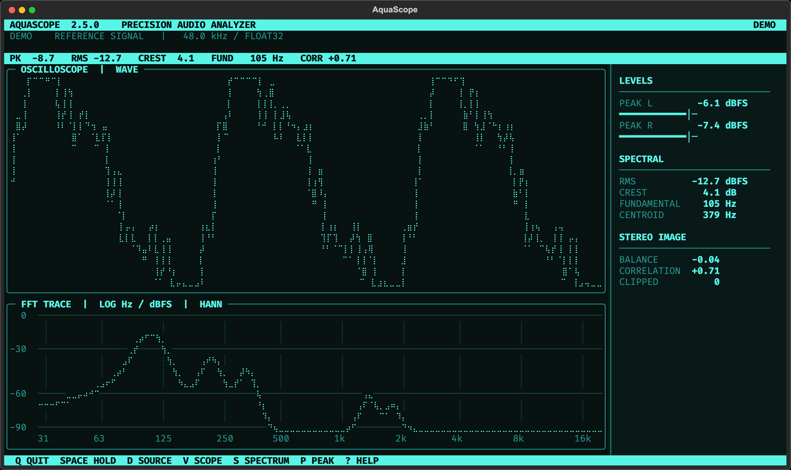
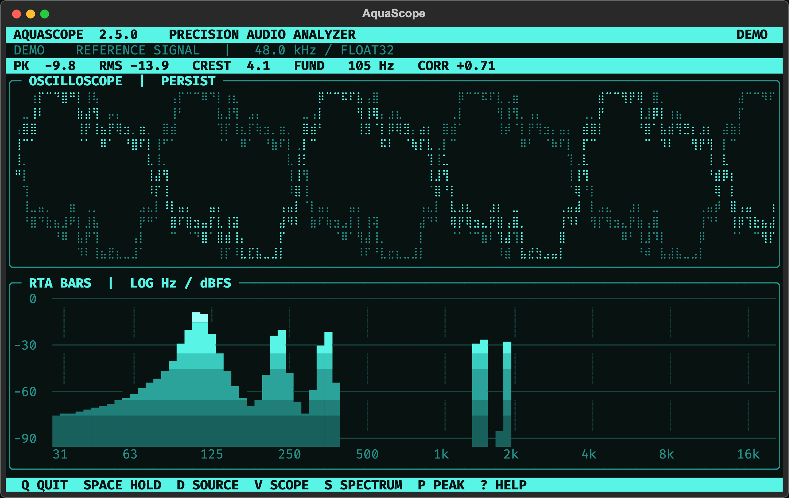
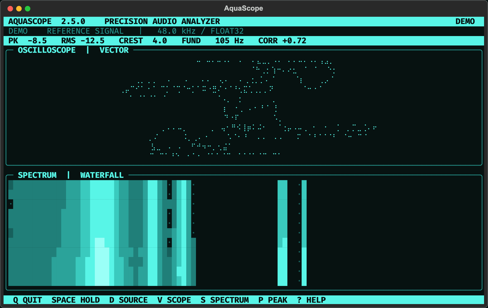
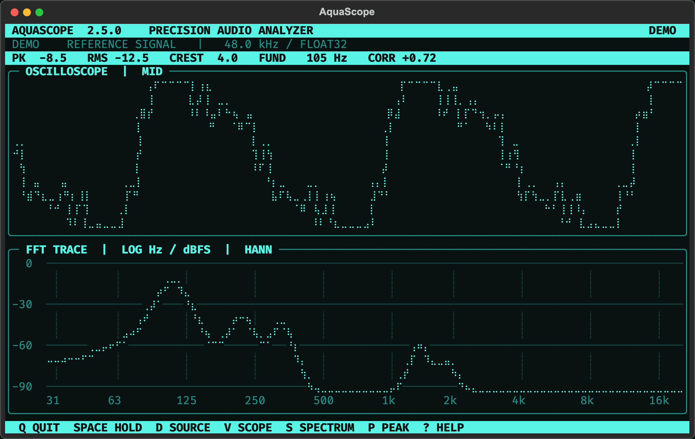
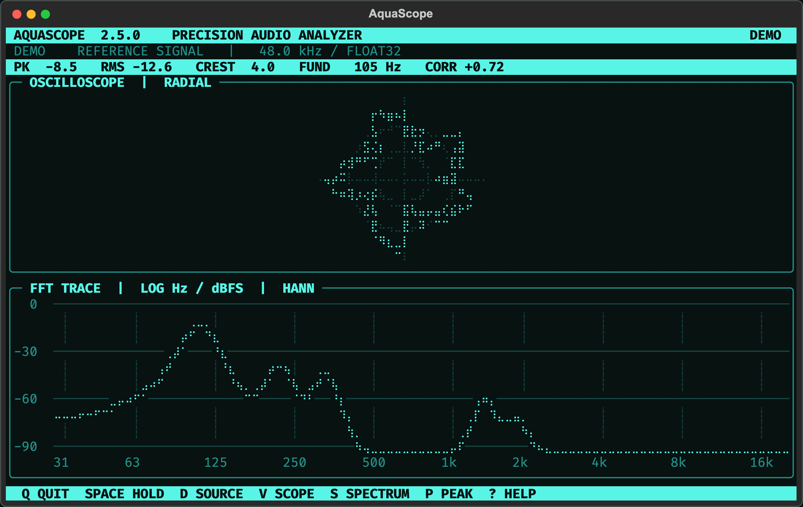

<div align="center">

# AquaScope

**A monochrome aqua oscilloscope and spectrum analyzer for your terminal.**

[](https://github.com/figgarden/aquascope/actions/workflows/ci.yml)


[](LICENSE)



</div>

AquaScope is a [Textual](https://textual.textualize.io/)-powered, CAVA-inspired instrument panel
for whatever your computer is playing. Install it, run `aquascope`, and it opens a live,
high-resolution analyzer with waveform, log-frequency spectrum, and signal telemetry, all in
a high-contrast aqua palette designed for dark terminals.

It runs entirely offline. No accounts, no network access, no telemetry. See [Privacy](#privacy).

## Features

**Oscilloscope**
- Stable zero-crossing trigger with automatic or manual gain
- High-resolution Braille rendering (2×4 dots per character cell)
- Phosphor-style **persistence** view
- Stereo engineering views: **mid**, **side**, and **vectorscope** (goniometer)
- Triggered **polar** oscilloscope with amplitude graticule

**Spectrum analyzer**
- Logarithmic 30 Hz–20 kHz axis with calibrated dBFS grid and frequency ticks
- Smooth Hann-windowed **FFT trace**, **RTA bars**, or a scrolling **waterfall**
- Optional peak-hold markers

**Telemetry**
- Peak and RMS level per channel with hold meters
- Crest factor, fundamental frequency, spectral centroid
- Stereo balance, phase correlation, clipping counter

**Usability**
- Picks a system-audio loopback device automatically and remembers your choice
- In-app audio-device picker (`d`)
- Click or tap either graph to cycle its view
- Compact layout for small screens (great on 7-inch displays)
- `--doctor` diagnostics and an automatic demo signal if audio is unavailable

## Gallery

| Persistence + RTA bars | Vectorscope + waterfall |
| --- | --- |
|  |  |
| **Mid channel** | **Polar scope** |
|  |  |

## Install

AquaScope needs **Python 3.11+** and a terminal with color and Unicode support. On Windows, use
[Windows Terminal](https://aka.ms/terminal).

The recommended install is with [pipx](https://pipx.pypa.io/), which keeps it isolated:

```bash
pipx install git+https://github.com/figgarden/aquascope.git
aquascope
```

Or with plain pip:

```bash
python3 -m pip install git+https://github.com/figgarden/aquascope.git
```

Just want to look? `aquascope --demo` runs with a built-in reference signal and touches no
audio hardware.

## Audio setup

AquaScope visualizes an **input** device. To see what your computer is *playing*, you need a
loopback (monitor) input. AquaScope looks for one automatically. Run `aquascope --doctor` to
check what it found.

<details open>
<summary><b>Linux</b> (PipeWire / PulseAudio)</summary>

Install PortAudio:

```bash
sudo apt install libportaudio2        # Debian / Ubuntu
sudo dnf install portaudio            # Fedora
sudo pacman -S portaudio              # Arch
```

PipeWire and PulseAudio expose each output as an input named `Monitor of …`. AquaScope picks
it automatically. If none appears, open `pavucontrol` → *Recording* and route AquaScope's
stream to the output's monitor.
</details>

<details>
<summary><b>macOS</b></summary>

macOS doesn't expose system playback as an input, so install the free
[BlackHole 2ch](https://existential.audio/blackhole/) driver (`brew install blackhole-2ch`), then:

1. Open **Audio MIDI Setup**.
2. Create a **Multi-Output Device** containing your speakers/headphones and BlackHole 2ch.
3. Set that Multi-Output Device as the system sound output.
4. Start AquaScope. It selects BlackHole automatically (or press `d`).

The first time AquaScope listens, macOS asks for microphone permission for your terminal app.
That is required for *any* audio input, including BlackHole.

PortAudio ships inside the `sounddevice` wheel. If needed: `brew install portaudio`.
</details>

<details>
<summary><b>Windows</b></summary>

PortAudio ships inside the `sounddevice` wheel, so nothing extra is needed. For a loopback
input, pick one of:

- **Stereo Mix** (built into many Realtek drivers): *Settings → System → Sound → More sound
  settings → Recording*, right-click → *Show disabled devices*, then enable **Stereo Mix**.
- **[VB-Audio Virtual Cable](https://vb-audio.com/Cable/)** (free): set *CABLE Input* as your
  playback device and AquaScope listens on *CABLE Output*. Use *Listen to this device* on CABLE
  Output if you still want to hear the sound.

Windows lists each device once per audio API. AquaScope prefers the **WASAPI** copy
automatically. Run AquaScope in **Windows Terminal** for correct Braille and color rendering.
If audio input is blocked, check *Settings → Privacy & security → Microphone* and allow desktop
apps.
</details>

## Usage

```text
aquascope                    auto-select a monitor/loopback input
aquascope --list-devices     print available inputs (* = automatic choice)
aquascope --device 4         start with input device 4
aquascope --sample-rate 48000
aquascope --fps 60           faster display refresh (10–60)
aquascope --demo             preview with a built-in reference signal
aquascope --doctor           diagnose audio and terminal setup
aquascope --layout compact   force the small-screen layout (auto | compact | full)
```

| Key | Action |
| --- | --- |
| `q` | Quit |
| `Space` | Freeze / resume |
| `d` | Select an audio input |
| `a` | Toggle automatic oscilloscope scaling |
| `↑` / `↓` | Increase / decrease display gain |
| `v` | Cycle waveform, persistence, mid, side, vectorscope, polar |
| `s` | Cycle FFT trace, RTA bars, waterfall |
| `p` | Toggle spectrum peak hold |
| `?` or `h` | Quick reference |
| *click* | Click either graph to cycle its view |

A terminal of at least **72 × 20** is recommended. The full layout with the telemetry panel
appears at 120 × 34 and up.

## Privacy

AquaScope is designed to keep everything on your machine:

- **No network access.** The app makes no HTTP requests, opens no sockets, and has no
  analytics, telemetry, or update checks.
- **Audio is never recorded.** Samples live in a ~0.3-second in-memory ring buffer used for
  drawing, and are discarded continuously. Nothing is written to disk.
- **One small settings file.** When you pick a device with `d`, its *name* is saved so it's
  reselected next time:
  - Linux / macOS: `~/.config/aquascope/config.json` (or `$XDG_CONFIG_HOME`)
  - Windows: `%APPDATA%\aquascope\config.json`

  Delete it any time to reset.
- **Safe diagnostics.** `aquascope --doctor` prints your OS, Python version, terminal, and audio
  device names, and shows your home folder as `~`. Device names can contain things like
  "Jane's AirPods", so review the output before pasting it publicly.

See [PRIVACY.md](PRIVACY.md) for details.

## Development

```bash
git clone https://github.com/figgarden/aquascope.git
cd aquascope
python3 -m venv .venv
source .venv/bin/activate          # Windows: .venv\Scripts\activate
pip install -e ".[dev]"
pytest
ruff check .
```

Regenerate the screenshots (uses the demo signal only) with `python tools/render_preview.py`.
That writes SVGs to `docs/`.

Project layout:

```text
src/aquascope/
  cli.py         command-line entry point and --doctor
  audio.py       PortAudio capture, device discovery, loopback detection
  dsp.py         FFT, levels, crest, centroid, correlation, log bands
  textual_ui.py  the Textual app, widgets, and Braille renderers
  config.py      the tiny local settings file
tests/           pytest suite (runs headless, no audio hardware needed)
```

Contributions are welcome. See [CONTRIBUTING.md](CONTRIBUTING.md).

## Notes

The `FLOAT32` label describes AquaScope's internal capture stream, not your DAC's bit depth. The
metrics are real-time engineering estimates, not calibrated mastering or compliance
measurements.

## License

Copyright © 2026 Gabriel Moreno.

AquaScope is free software, licensed under the
[GNU General Public License, version 3 or later](LICENSE).

## Credits

- **Creator:** Gabriel Moreno
- **AI assistance:** Claude.ai Sonnet via Perplexity, and Claude Code
- Built with [Textual](https://github.com/Textualize/textual),
  [Rich](https://github.com/Textualize/rich), [NumPy](https://numpy.org/), and
  [python-sounddevice](https://github.com/spatialaudio/python-sounddevice) /
  [PortAudio](https://www.portaudio.com/)
